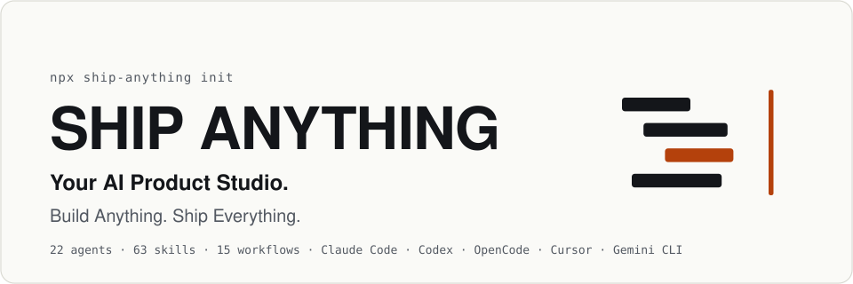
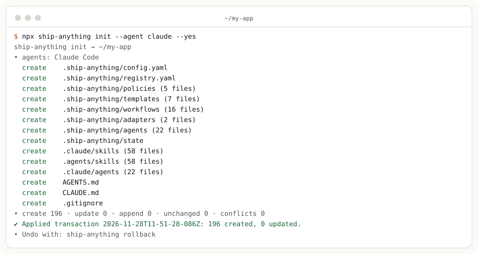
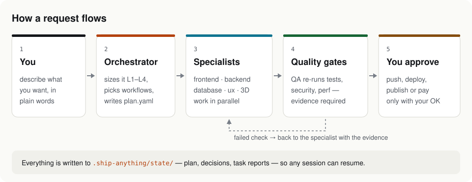

<div align="center">

<picture>
  <source media="(prefers-color-scheme: dark)" srcset="assets/readme/hero-dark.svg">
  
</picture>

[](https://www.npmjs.com/package/ship-anything)
[](LICENSE)
[](https://nodejs.org)

**Turn the AI coding agent you already use into a small product team.**

[Quick start](#quick-start-5-minutes) · [How it works](#how-it-works) · [Glossary](#words-you-will-see) · [FAQ](#faq) · [Full guide](docs/guides/getting-started.md)

</div>

---

## What is this?

AI coding agents like **Claude Code**, **Codex**, **OpenCode**, **Cursor** and **Gemini CLI** can write code,
but on big requests they tend to skip planning, say "done" without testing, and lose track of what they were
doing.

SHIP ANYTHING fixes that by adding instructions to your project. It doesn't add another AI. After you install
it, your agent works like a product team:

- a **lead** (the *orchestrator*) that plans the work and keeps everyone honest;
- **22 specialists** for frontend, backend, database, design, 3D, video, security, QA, release and more;
- **57 skills**: step-by-step playbooks the specialists load only when they need them;
- **15 workflows**: ready-made routes for a website, web app, mobile app, 3D product, video and other kinds of work;
- **safety rules**: it asks you before anything risky, such as pushing code, deploying, publishing or spending money.

It's all plain Markdown and YAML files in your project. You can read every rule, change any of them, or
remove the whole thing with one command.

## Quick start (5 minutes)

**You need:**
1. **Node.js 20 or newer.** Check with `node --version`; if it's missing, install it from [nodejs.org](https://nodejs.org).
2. **One AI coding agent**, such as [Claude Code](https://docs.anthropic.com/en/docs/claude-code),
   [Codex CLI](https://github.com/openai/codex) or [OpenCode](https://opencode.ai).
3. **git** (recommended), so you can undo anything.

**Step 1: create or open a project folder**

```bash
mkdir my-app && cd my-app
git init
```

**Step 2: install SHIP ANYTHING into it**

```bash
npx ship-anything init
```

It detects which agents you have, shows you what it will add, and asks before writing. You'll see
something like this:

<picture>
  <source media="(prefers-color-scheme: dark)" srcset="assets/readme/init-terminal-dark.svg">
  
</picture>

Save a clean starting point, so you can always get back to it:

```bash
git add -A && git commit -m "Install SHIP ANYTHING"
```

**Step 3: start your agent in the same folder**

| Agent | Command | Note |
|---|---|---|
| Claude Code | `claude` | Optional: `claude --agent orchestrator` |
| Codex | `codex` | Say **yes** when it asks to trust the project, otherwise the specialists don't load |
| OpenCode | `opencode` | Press <kbd>Tab</kbd> to select **orchestrator** |
| Cursor, Gemini CLI, others | open the folder as usual | |

**Step 4: say what you want in plain words**

```text
Build a simple website for my bakery: home page, menu with prices, opening hours,
and a contact form. Keep it fast and mobile-friendly. Use SHIP ANYTHING.
```

That's it. You don't need to name agents or skills; the orchestrator picks them. While it works, you can
see its plan in `.ship-anything/state/plan.yaml`.

## How it works

<picture>
  <source media="(prefers-color-scheme: dark)" srcset="assets/readme/how-it-works-dark.svg">
  
</picture>

1. **Size the job.** A typo fix is **L1** and gets done directly with no ceremony. A full platform is
   **L4** and gets research, design, architecture and several build waves.
2. **Plan.** The orchestrator writes `plan.yaml`: which specialist does what, which files each one owns,
   and in what order.
3. **Build in parallel.** Specialists work at the same time only when they touch different files, so
   they don't overwrite each other.
4. **Prove it.** A separate QA specialist re-runs the tests. Nothing is marked done without real
   evidence, such as a command and its output. Security and performance checks run when the job needs them.
5. **Ask first.** Pushing, deploying, publishing, paying for things, changing DNS or deleting data
   always waits for your OK.
6. **Hand off.** You get a summary of what was built, how it was checked, what it assumed, and what's
   still missing.

## What to ask for

| Size | Example request | What happens |
|---|---|---|
| L1 | "Fix the broken link in the footer." | Done directly, no plan |
| L2 | "Add a contact form with server-side validation and tests." | Short plan, one or two specialists, QA check |
| L3 | "Build a booking app with accounts, an admin page and email confirmations." | Design, backend, frontend, QA and security in waves |
| L4 | "Build a restaurant platform: ordering site, admin dashboard, staff app, payments, 3D menu." | Full product team with research, architecture and several build waves ([walkthrough](docs/guides/example-restaurant-platform.md)) |

Tips for better results:
- **Describe the outcome, not the steps.** Say who it's for and what "done" looks like.
- **Mention constraints:** framework, hosting, budget, "no paid services", deadlines.
- **On big jobs, commit often.** The agent will ask whether it may make local checkpoint commits.
- **Coming back later?** Open the agent and say "continue". It resumes from `.ship-anything/state/`.

## Words you will see

| Word | Meaning |
|---|---|
| **Orchestrator** | The lead agent. It plans, hands out tasks, checks results and reports to you |
| **Agent / specialist** | A role with its own instructions, like `frontend-agent` or `qa-agent` ([list](agents/)) |
| **Skill** | A playbook (`SKILL.md`) for one kind of work, such as accessibility or database design. Loaded only when needed ([catalog](docs/architecture/catalog.md)) |
| **Workflow** | A route through the work for one kind of product, such as `website`, `web-app` or `3d-product` ([list](workflows/README.md)) |
| **Level (L1–L4)** | How big and risky the job is. It decides how much process is used |
| **Gate** | A checkpoint (QA, security, performance, release) the work must pass |
| **Status** | `PLANNED → IN_PROGRESS → IMPLEMENTED → TESTED → VERIFIED → DEPLOYED → SHIPPED`. It moves forward only with evidence |
| **State** | Files in `.ship-anything/state/` (plan, decisions, task reports) that let any session pick up where the last one stopped |

## FAQ

**Does it cost anything?** SHIP ANYTHING is free (MIT). Your agent's normal usage costs still apply, and
big L4 jobs use a lot of tokens.

**Will it deploy or push code on its own?** No. Those actions always wait for your explicit OK.

**Can I use it in an existing project?** Yes. `init` adds a marked block to your existing `AGENTS.md`,
`CLAUDE.md` and `.gitignore` and never overwrites files you've changed. For existing code, ask it to
"audit this project first".

**How do I remove it?** Run `npx ship-anything rollback` to undo the last install, or delete
`.ship-anything/` and the agent folders it created.

**How do I update it?** Run `npx ship-anything@latest update`. Files you've edited are skipped and
reported as conflicts.

**Can it reverse-engineer an app?** Yes, for systems you own or are allowed to analyse: undocumented code,
your own APIs, file formats, or legacy apps. It maps how the system works and pins the behaviour with
tests before anything gets changed. It won't help bypass logins, DRM or licence checks, and "clone
this product" work uses only its public surface ([reverse-engineer workflow](workflows/reverse-engineer.md)).

**Codex doesn't show the specialists.** Trust the project when Codex asks (or restart Codex in that
folder and accept). Untrusted projects don't load `.codex/agents/`.

**Something went wrong. How do I start over?** If you committed after install, run
`git reset --hard && git clean -fd`. Or run `npx ship-anything doctor` to check the install.

## Why

AI coding agents are capable, but on large requests they skip discovery, mark work "done" without running
it, overwrite each other's files, and burn context re-reading everything. SHIP ANYTHING adds the structure
a good delivery lead brings:

| Problem | What SHIP ANYTHING does |
|---|---|
| "Done" without proof | Status model `PLANNED → IMPLEMENTED → TESTED → VERIFIED → DEPLOYED → SHIPPED`. Each step needs recorded evidence, and QA is independent of the implementer. |
| Every request gets the same heavy process | Levels L1–L4, scored on deliverables, contracts and risk (not prompt length). An L1 change uses one skill and no ceremony. |
| Parallel agents collide | Task contracts with `owns:` globs. Overlapping tasks never run concurrently, and integration happens at checkpoints. |
| Context bloat | Progressive disclosure, compact contracts and reports instead of transcripts, and continuation summaries. |
| Risky autonomy | Production deploys, publishing, pushes, paid resources, DNS and destructive operations always ask a human first. |
| Generic "AI-looking" UIs | The UX agent sets a product-specific direction and reviews rendered screens. A design-skill routing rule picks one lead skill per task. |

## CLI reference

| Command | Purpose |
|---|---|
| `init [--agent …] [--dry-run] [--yes] [--force]` | Install into a project (preview first; backups on `--force`) |
| `update` | Re-apply bundled content for the installed agents; your edits are skipped as conflicts |
| `rollback` | Undo the last `init` or `update` |
| `doctor` | Check Node, git, installed agents, the project install and optional tools (ffmpeg, Blender, Docker, …) |
| `validate` | Validate content (in this repo) or an installation (in a project) |
| `skills list \| add <src> \| approve <name> \| remove <name>` | Manage skills. External skills are quarantined and statically reviewed, and are never executed by the CLI. |
| `agents list \| show <name>` | Inspect the specialists |

## Architecture

```
request → ORCHESTRATOR ─ classify (L1–L4) → workflows → plan.yaml → task contracts
              │
              ├─ wave 1 ─► product-director · research-agent · architecture-agent · ux-agent
              ├─ wave 2 ─► frontend · backend · database · integration · mobile · 3D · motion · video …
              ├─ integrate (build + tests) ─► QA gate ─► security gate ─► performance gate
              └─ release-agent ─(human authorization)─► deploy ─► verify ─► handoff report
```

There are four layers: orchestration, specialists, the skill and tool registry, and delivery. Details are in
[docs/architecture/overview.md](docs/architecture/overview.md), and decisions in
[docs/research/architecture-decisions.md](docs/research/architecture-decisions.md).

### Agents

orchestrator · product-director · research-agent · architecture-agent · ux-agent · frontend-agent ·
backend-agent · mobile-agent · desktop-agent · database-agent · integration-agent · threejs-agent ·
blender-agent · motion-agent · video-agent · infrastructure-agent · monitoring-agent · security-agent ·
performance-agent · qa-agent · release-agent · documentation-agent. See [agents/](agents/).

### Skills

| Category | Skills |
|---|---|
| Product intelligence | product-discovery, product-research, requirements-analysis, architecture-planning, competitive-product-analysis, existing-project-audit, reverse-engineering, rust-modernization |
| Software engineering | frontend, backend, fullstack, database, API, integrations, auth, mobile, desktop, cross-platform |
| Design | ui-ux-design, design systems, accessibility, polish, interaction, responsive, motion, visual regression |
| Creative production | Three.js, Blender, 3D product pipeline, Remotion, video editing, sound, VFX, asset pipeline, creative direction |
| Quality | testing & QA, browser automation, API testing, security audit, performance, regression prevention, production readiness, code review |
| Delivery | infrastructure, deployment, release management, documentation, environments, CI/CD, observability |
| Efficiency | token optimization, context management, persistent memory, parallel coordination, codebase intelligence, repository mapping, terminal output |

The full catalog is in [docs/architecture/catalog.md](docs/architecture/catalog.md).

Upstream skills such as Anthropic `frontend-design`, Impeccable, Emil Kowalski's motion skills, Repomix and
Remotion are **registered, not vendored**. Each entry records license, security notes and install command in
[.ship-anything/registry.yaml](.ship-anything/registry.yaml). The research behind each verdict is in
[docs/research/skill-candidates.md](docs/research/skill-candidates.md).

### Workflows

build-anything (router) · product-discovery · website · web-app · mobile-app · desktop-app ·
fullstack-platform · 3d-product · video-production · clone-existing-product · reverse-engineer ·
improve-existing-project · legacy-modernization · security-remediation · production-release.
See [workflows/README.md](workflows/README.md).

## Token efficiency

Measured with `node scripts/benchmark/context-budget.mjs` on 2026-11-26 (22 agents, 57 skills, 15 workflows).
This is a static measure of instruction volume, with tokens **estimated** as bytes/4:

| Scenario | Est. tokens | % of load-everything baseline |
|---|---|---|
| Baseline: every agent + skill + workflow in context | 160,036 | 100% |
| Startup: instruction block + skill names/descriptions | 6,786 | 4.2% |
| Typical task: frontend-agent + web-app workflow + required skills | 17,643 | 11.0% |
| Typical task: backend-agent + fullstack-platform | 18,848 | 11.8% |
| Typical task: video-agent + video-production | 15,379 | 9.6% |

Raw output: `reports/context-budget.json`.

Method and limits are documented in [docs/token-efficiency.md](docs/token-efficiency.md). We publish no
model-usage savings figures until they've been measured on real runs.

## Compatibility

| Agent | Instructions | Skills | Subagents | Verified on |
|---|---|---|---|---|
| Claude Code | `CLAUDE.md` → `@AGENTS.md` | `.claude/skills` | `.claude/agents/*.md` | 2.1.332. All 22 agents and the skills were discovered in a test project. |
| OpenCode | `AGENTS.md` | `.agents/skills` | `.opencode/agents/*.md` | 1.19.5. `opencode agent list` showed all 22 agents. |
| Codex | `AGENTS.md` | `.agents/skills` | `.codex/agents/*.toml` | 0.160.1. Skills and all custom agents work once the project is trusted; a field run spawned 43 specialist subagents. |
| Cursor | `AGENTS.md` | `.agents/skills` | `.cursor/agents/*.md` | Not tested (docs only) |
| Gemini CLI | `GEMINI.md` → `@./AGENTS.md` | `.agents/skills` | `.gemini/agents/*.md` | Not tested (docs only) |
| Other | `AGENTS.md` | `.agents/skills` | single-session fallback | n/a |

Evidence and per-agent caveats are in [.ship-anything/adapters/](.ship-anything/adapters/) and
[docs/research/integration-matrix.md](docs/research/integration-matrix.md).

## Roadmap

- **0.1** (this release): agents, skills, workflows, policies, adapters, and the npm CLI with tests and CI.
- **0.2**: verify the Cursor and Gemini CLI adapters on real installs; record the first end-to-end demos.
- **0.3**: measured token benchmarks on real tasks; `skills update` with diff review; an optional NEXUS export
  ([spec](docs/integrations/nexus-integration.md)).
- Later: example applications built end-to-end, community skill index, more adapters.

## Contributing

Read [CONTRIBUTING.md](CONTRIBUTING.md) and [docs/community/contribution-roadmap.md](docs/community/contribution-roadmap.md).
To work on SHIP ANYTHING itself:

```bash
git clone https://github.com/offlineAu/ship-anything.git && cd ship-anything && npm install
node packages/cli/bin/ship-anything.js init --agent claude --cwd /path/to/test-project
npm run check
```

Run `npm run check` before opening a PR. Maintainers: see [docs/guides/releasing.md](docs/guides/releasing.md).

## Security

Please report vulnerabilities privately, as described in [SECURITY.md](SECURITY.md). The threat model is in
[docs/security-model.md](docs/security-model.md).

## License

[MIT](LICENSE). Third-party skills referenced in the registry aren't distributed with this project and keep
their own licenses. For example, Remotion's skills come under the Remotion License, which requires a paid
company license for organizations of more than three people.

## Acknowledgments

This design builds on ideas from the projects we researched: the Agent Skills format and Anthropic's skills;
vercel-labs/skills (directory conventions); Impeccable, Emil Kowalski's skills, Taste and UI UX Pro Max
(design); Repomix, RTK, context-mode, claude-mem and Headroom (context efficiency); pragmatic-orchestration,
metaswarm and mco (orchestration); rea, reverse-engineer-anything and rust-anything (reverse engineering and
modernization); Remotion, dolly and motion-tools-and-skills (video). None of them endorse this project.
